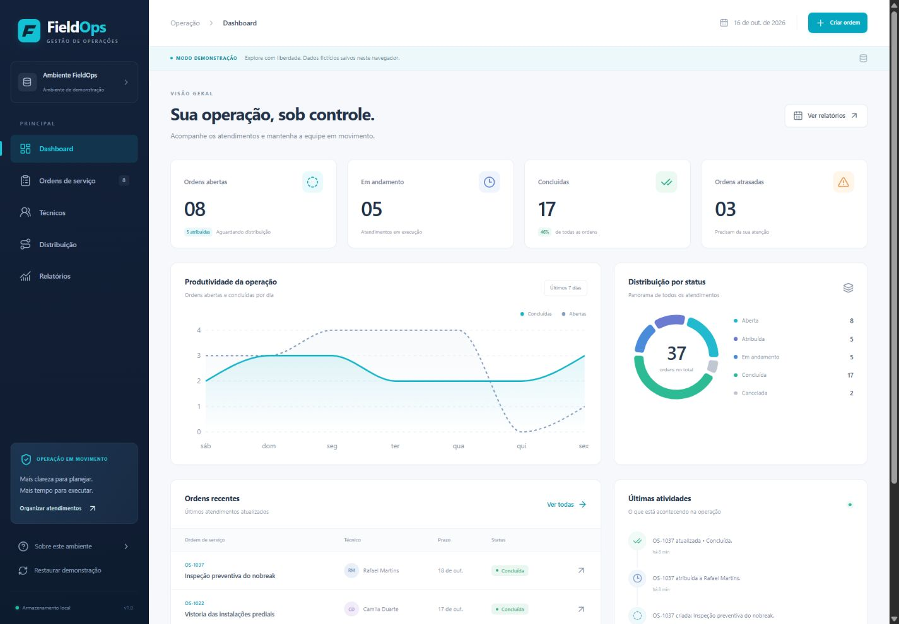

# FieldOps

[](https://github.com/Diogocvlh/fieldops/actions/workflows/ci.yml)

Sistema de gerenciamento de ordens de serviço e equipes técnicas. O monorepo reúne uma interface em português brasileiro, uma API Java e regras operacionais compartilhadas por contrato, com execução local e opção de PostgreSQL hospedado no Supabase.

[Funcionalidades](#funcionalidades) · [Executar a demonstração](#executar-o-frontend) · [Executar a API](#executar-a-api-com-h2) · [Arquitetura](docs/ARCHITECTURE.md) · [Verificações](#verificação)



[Ordens no desktop](docs/assets/ordens-desktop.jpg) · [Ordens no celular](docs/assets/ordens-mobile.jpg)

[Interface conectada à API Java local](docs/assets/api-java.jpg)

O projeto é um MVP de portfólio. A API desta etapa não possui autenticação ou autorização; use-a localmente. Uma implantação pública exige controles de acesso e uma revisão de segurança.

## Funcionalidades

- **Dashboard:** indicadores de ordens, atrasos, produtividade e atividades recentes.
- **Ordens de serviço:** consulta, pesquisa, filtros, cadastro, edição, detalhamento e exclusão.
- **Técnicos:** cadastro, matrícula única, especialidade, região, disponibilidade e capacidade.
- **Distribuição:** atribuição manual com verificação de disponibilidade e carga ativa.
- **Relatórios:** totais e recortes por período, status e técnico, calculados a partir dos registros.

As ordens recebem um identificador UUID e um código único. A conclusão registra sua data automaticamente. Os dados de exemplo usam nomes e operações fictícios.

## Decisões de engenharia

- **Acesso aos dados por adaptadores:** a interface utiliza o mesmo contrato nos modos localStorage e HTTP.
- **Regras no domínio:** atribuições verificam disponibilidade e capacidade; no backend, alterações e atividades são gravadas na mesma transação.
- **Evolução do banco por migrações:** Flyway versiona o schema PostgreSQL, mantendo credenciais no processo Java.
- **Verificação automatizada:** a CI executa testes, verificação de tipos, build do frontend e teste de migrações com PostgreSQL.

Consulte a [arquitetura](docs/ARCHITECTURE.md), o [contrato de integração](CONTRACT.md) e a [apresentação técnica](docs/PORTFOLIO.md) para os detalhes e os limites do MVP.

## Tecnologias

| Camada | Tecnologias |
| --- | --- |
| Interface | React, TypeScript, Vite, Tailwind CSS, Recharts |
| API | Java 21, Spring Boot 4.1.1, Maven, Bean Validation, Spring Data JPA |
| Persistência | localStorage, H2 em memória, PostgreSQL e Flyway |
| Integração contínua | GitHub Actions, jobs separados para frontend e backend |

## Modos de execução

| Modo | Configuração | Onde os dados ficam |
| --- | --- | --- |
| Demonstração no navegador — padrão | `VITE_DATA_MODE=demo` | localStorage da origem e do navegador utilizados |
| Interface + API de demonstração | `VITE_DATA_MODE=api` e backend no profile `demo` | H2 em memória, com seed fictício |
| Interface + API PostgreSQL | `VITE_DATA_MODE=api` e backend no profile `postgres` | PostgreSQL, inclusive uma instância Supabase configurada por JDBC |

Os modos usam bases independentes. Trocar de modo não transfere os registros. A demonstração do navegador sobrevive ao recarregamento, mas pode ser apagada ao limpar o armazenamento do site. O H2 perde os registros quando o processo Java termina. O profile `postgres` não insere o seed de demonstração.

O modo API apresenta falhas de conexão ao usuário e não troca silenciosamente para localStorage. Nenhum modo cria uma conexão fictícia com o Supabase.

## Estrutura

```text
fieldops-portfolio/
├── frontend/            # Interface, modelos, serviços e adaptadores
├── backend/             # API REST, regras de negócio e migrações
├── docs/
│   ├── ARCHITECTURE.md  # Limites das camadas e decisões técnicas
│   ├── API.md           # Endpoints, modelos e regras
│   ├── SUPABASE.md      # Configuração PostgreSQL pelo backend
│   └── PORTFOLIO.md     # Apresentação técnica do projeto
├── .github/workflows/ci.yml
└── CONTRACT.md          # Contrato de integração
```

## Pré-requisitos

- Node.js 22.12 ou superior e npm.
- JDK 21 para executar ou verificar o backend.
- Acesso à internet na primeira instalação para baixar dependências e a distribuição do Maven Wrapper.
- VS Code ou outro editor de sua preferência.

O frontend em demonstração pode ser executado sem Java e sem banco externo.

## Executar o frontend

Na raiz do repositório, em PowerShell:

```powershell
Set-Location frontend
Copy-Item .env.example .env.local
npm ci
npm run dev
```

Em Linux ou macOS:

```bash
cd frontend
cp .env.example .env.local
npm ci
npm run dev
```

Abra o endereço informado pelo Vite, normalmente `http://127.0.0.1:5173`. O arquivo de exemplo seleciona a demonstração. Não substitua um `.env.local` existente sem revisar seus valores.

## Executar a API com H2

Em um segundo terminal, a partir da raiz, em PowerShell:

```powershell
Set-Location backend
.\mvnw.cmd spring-boot:run "-Dspring-boot.run.profiles=demo"
```

Em Linux ou macOS:

```bash
cd backend
chmod +x mvnw
./mvnw spring-boot:run -Dspring-boot.run.profiles=demo
```

A API utiliza `http://localhost:8080/api/v1`. Consulte `GET /api/v1/health` para identificar o profile em execução. O profile padrão também é `demo`.

Para conectar a interface, altere `frontend/.env.local` e reinicie o Vite:

```dotenv
VITE_DATA_MODE=api
VITE_API_URL=http://localhost:8080/api/v1
```

As variáveis `VITE_*` são públicas no bundle do navegador. Elas recebem apenas o modo e a URL da API, nunca credenciais de banco.

## Configuração do backend

| Variável | Uso | Padrão |
| --- | --- | --- |
| `SPRING_PROFILES_ACTIVE` | `demo` ou `postgres` | `demo` |
| `SERVER_PORT` | Porta HTTP | `8080` |
| `CORS_ALLOWED_ORIGINS` | Origens permitidas, separadas por vírgula | `http://localhost:5173,http://127.0.0.1:5173` |
| `APP_TIME_ZONE` | Fuso das regras de datas e relatórios | `America/Sao_Paulo` |
| `DB_URL` | URL JDBC no profile `postgres` | Obrigatória nesse profile |
| `DB_USERNAME` | Usuário PostgreSQL | Obrigatória nesse profile |
| `DB_PASSWORD` | Senha PostgreSQL | Obrigatória nesse profile |

O Spring recebe variáveis do ambiente do processo; copiar um arquivo `.env` não o carrega automaticamente. Use as configurações de execução do editor ou exporte as variáveis no terminal. O guia [Supabase](docs/SUPABASE.md) contém exemplos com placeholders e orientações sobre o schema `fieldops`.

## Verificação

Execute os mesmos comandos previstos na integração contínua antes de compartilhar alterações. Eles não dependem de uma conta Supabase.

Frontend, dentro de `frontend/`:

```bash
npm ci
npm run check
npm test
npm run build
```

Backend, dentro de `backend/`, em PowerShell:

```powershell
.\mvnw.cmd verify
```

Em Linux ou macOS:

```bash
./mvnw verify
```

O workflow [CI](.github/workflows/ci.yml) define essas etapas e disponibiliza um PostgreSQL 17 temporário para o teste de migrações. Sem `DB_URL` PostgreSQL, a verificação local usa H2 e ignora esse teste condicional. Consulte [Verificação do MVP](docs/VALIDATION.md) para os resultados locais.

Com o backend `demo` em execução, um smoke test HTTP opcional percorre fluxos da API. Ele exige Python 3, valida o modo antes de alterar registros e cria dados fictícios temporários, removidos ao finalizar. A partir da raiz:

```bash
python scripts/smoke_api.py
```

No Windows, `py -3 scripts/smoke_api.py` é uma alternativa quando o Python Launcher está instalado.

Para verificação manual, percorra o cadastro de técnico, a criação de OS, a atribuição, o início e a conclusão. Confira também técnico indisponível, capacidade excedida, matrícula duplicada e exclusão de técnico vinculado. Recarregue a demonstração para verificar persistência. Em modo API, interrompa o backend e confirme a mensagem de erro. Detalhes das regras estão em [API](docs/API.md).

## Documentação

- [Arquitetura e evolução](docs/ARCHITECTURE.md)
- [Contrato HTTP e regras](docs/API.md)
- [PostgreSQL e Supabase](docs/SUPABASE.md)
- [Apresentação para portfólio](docs/PORTFOLIO.md)
- [Publicar o código no GitHub](docs/GITHUB.md)
- [Verificação do MVP](docs/VALIDATION.md)
