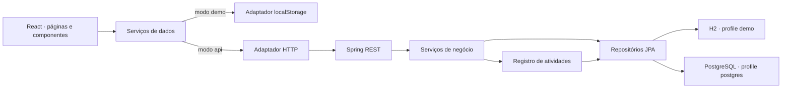

# Arquitetura do FieldOps

## Organização

O FieldOps mantém frontend e backend no mesmo repositório, com builds independentes. O contrato em `CONTRACT.md` define os nomes dos campos, os enums, o formato dos erros e as regras que precisam produzir o mesmo resultado nos dois modos de dados.

Os dois caminhos não se sincronizam. O localStorage é uma demonstração individual; a API é a fronteira para evolução da persistência e para regras centralizadas em cenários com múltiplos clientes.

## Frontend

As páginas representam Dashboard, Ordens de serviço, Técnicos, Distribuição e Relatórios. Componentes reutilizáveis cuidam da apresentação: navegação, formulários, tabelas, indicadores, feedback e estados vazios. Tipos definem os modelos de domínio, e utilitários concentram formatação e cálculo de datas.

O acesso aos dados passa por serviços e adaptadores. A seleção usa `VITE_DATA_MODE`; o modo API recebe sua base em `VITE_API_URL`. Componentes não precisam conhecer credenciais PostgreSQL ou detalhes de JDBC. Falhas HTTP são apresentadas e não provocam fallback para outra base.

No modo local, uma mutação atualiza os registros e a atividade correspondente no mesmo snapshot persistido. A interface recarrega o estado utilizado pelos indicadores após a operação. O navegador continua sujeito a limites de armazenamento e concorrência entre abas; localStorage não substitui um banco transacional.

## Backend

Controladores HTTP recebem DTOs e aplicam a validação de entrada. Serviços concentram transições de status, disponibilidade, capacidade, unicidade e registro de atividades. Repositórios JPA isolam o acesso aos registros persistidos. O tratamento central de exceções traduz erros para `{ title, detail, status, fieldErrors? }`.

As mutações de negócio e seu registro de atividade compartilham uma transação no backend. A base mantém restrições para identificadores, códigos e referências; verificações de negócio continuam necessárias para explicar conflitos ao cliente.

Flyway administra a evolução do schema `fieldops`. O profile `demo` utiliza H2 em memória em modo de compatibilidade PostgreSQL e adiciona dados fictícios. O profile `postgres` usa a conexão JDBC configurada no ambiente e não aplica esse seed.

O uso de H2 permite executar a aplicação sem infraestrutura externa. Ele não comprova compatibilidade integral com PostgreSQL: migrações, bloqueios, restrições e concorrência também precisam ser exercitados no banco de destino antes de uma implantação.

## Regras de domínio

| Regra | Comportamento |
| --- | --- |
| Identidade | UUID por registro e código de OS único, gerado e imutável |
| Matrícula | Única sem distinção entre maiúsculas e minúsculas |
| Ordem aberta | Não possui técnico |
| Ordem atribuída ou em andamento | Exige técnico |
| Nova atribuição | Técnico disponível e com carga menor que a capacidade |
| Carga ativa | Conta somente `ASSIGNED` e `IN_PROGRESS` |
| Conclusão | Preenche `completedAt` automaticamente |
| Reabertura | Limpa `completedAt`; retorno a status ativo valida disponibilidade e capacidade |
| Histórico | Ordens concluídas ou canceladas podem preservar o técnico |
| Exclusão de técnico | Bloqueada se houver qualquer OS vinculada |
| Redução de capacidade | Bloqueada abaixo da carga ativa atual |
| Prazo | Data real e igual ou posterior ao dia de abertura no fuso de negócio |
| Atraso | Prazo anterior ao dia atual e status diferente de concluída ou cancelada |

A edição de uma ordem ativa mantendo o mesmo técnico é permitida se sua disponibilidade mudou. Alterar uma ordem terminal para ativa volta a verificar os critérios, mesmo que o técnico seja o mesmo.

## Datas e indicadores

Datas de prazo usam `YYYY-MM-DD`. Instantes de criação, atualização, conclusão e atividades usam ISO 8601. O backend interpreta os dias de negócio em `APP_TIME_ZONE`, cujo padrão é `America/Sao_Paulo`; a demonstração local usa o calendário do navegador.

Os recortes de ordens em relatórios usam o dia de `createdAt`, com limites inclusivos. A produtividade representa conclusões pelo dia de `completedAt`; uma ordem aberta antes do período ainda pode contar como conclusão dentro dele. O contrato HTTP explicita essa distinção.

O frontend local e a API podem apresentar diferenças de data se o navegador estiver em um fuso diferente do backend. Para comparar os dois modos em testes manuais, use o mesmo fuso de negócio.

## Configuração e limites

O frontend contém apenas configuração pública. `DB_URL`, `DB_USERNAME` e `DB_PASSWORD` pertencem exclusivamente ao processo Java. O Supabase atua como serviço PostgreSQL; a interface se comunica com a API FieldOps, sem acesso direto à Data API do Supabase.

A API desta etapa atende ao desenvolvimento local sem autenticação. CORS configura as origens de navegador permitidas. Uma evolução para uso por equipes poderá acrescentar autenticação, permissões e isolamento por organização.

## Caminho de evolução

As próximas etapas são autenticação, permissões por função, paginação no servidor, controle de versões para edições concorrentes, ampliação dos testes com PostgreSQL e observabilidade.
